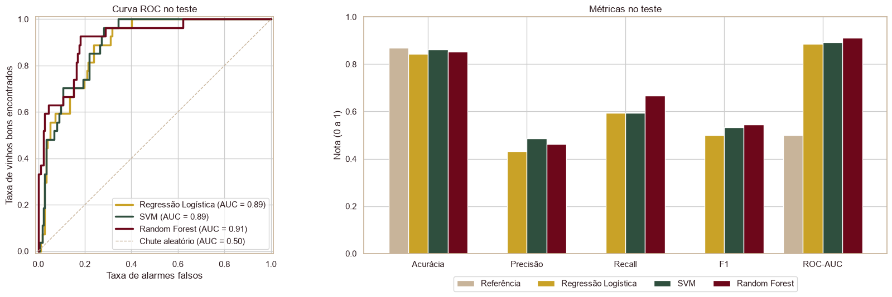
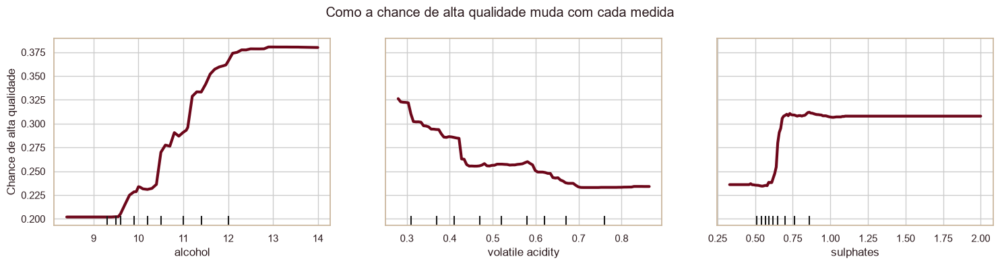

# 🍷 Classificação da Qualidade de Vinhos

Projeto de Machine Learning da **Pós Tech em Data Analytics – Fase 2**. O modelo prevê se um vinho é de **alta qualidade** a partir de medidas de laboratório (álcool, acidez, sulfatos etc.).

## O problema

Hoje a qualidade de um vinho é avaliada por especialistas em degustação, um processo **subjetivo, caro e demorado**. A ideia é usar dados que a vinícola já mede na produção para **antecipar** quais lotes têm potencial de alta qualidade.

- **Base:** [WineQT](data/WineQT.csv), com 1.143 vinhos tintos (1.018 depois de remover os repetidos) e 11 medidas físico-químicas.
- **Variável alvo:** a nota dos especialistas (0 a 10) virou uma classificação binária:

| Classe | Regra | Vinhos |
|---|---|---|
| **1 – Alta qualidade** | nota ≥ 7 | 137 (13,5%) |
| **0 – Baixa/média** | nota < 7 | 881 (86,5%) |

## Estrutura do repositório

```
tc-wine-quality-classification/
│
├── data/                 # Base de dados (WineQT.csv)
├── notebooks/            # Notebook com a análise completa (WineQT.ipynb)
├── src/                  # Scripts do pipeline
│   ├── config.py         #   caminhos, semente e paleta de cores
│   ├── preprocessing.py  #   carga, limpeza, novas features e padronização
│   ├── modeling.py       #   modelos, ajuste fino, ponto de corte e métricas
│   ├── train.py          #   executa o pipeline e salva as tabelas (.csv)
│   └── exportar_figuras.py  # salva os 23 gráficos do notebook em results/
├── results/              # Tabelas (.csv) e os 23 gráficos do notebook (figuras/)
├── docs/                 # Apresentações (storytelling e vídeo executivo)
├── requirements.txt      # Bibliotecas utilizadas
└── README.md             # Este arquivo
```

## Apresentações

- 📊 **Storytelling da análise exploratória:** [PDF](docs/storytelling_analise_exploratoria.pdf) 
- 🎬 **Vídeo executivo:** [assistir](docs/Apresentacao_Executiva_WineQT.mp4) · [PPTX](docs/Apresentacao_Executiva_WineQT.pptx)

## Como executar

```bash
# 1. Clonar o repositório
git clone https://github.com/<seu-usuario>/tc-wine-quality-classification.git
cd tc-wine-quality-classification

# 2. (Opcional) Criar um ambiente virtual
python -m venv .venv
source .venv/bin/activate      # Windows: .venv\Scripts\activate

# 3. Instalar as bibliotecas
pip install -r requirements.txt

# 4. Abrir o notebook com a análise explicada passo a passo
jupyter notebook notebooks/WineQT.ipynb

# 5. Regerar os resultados
python src/train.py              # tabelas (.csv) em results/
python src/exportar_figuras.py   # gráficos do notebook em results/figuras/
```

O `exportar_figuras.py` copia os gráficos do notebook já executado. Assim, `results/figuras/` mostra exatamente os mesmos gráficos da análise.

### O que tem em `results/`

| Arquivo | Conteúdo |
|---|---|
| `divisao_treino_teste.csv` | Vinhos de cada classe na base, no treino e no teste |
| `metricas_validacao_cruzada.csv` | Média das 5 rodadas por modelo |
| `validacao_cruzada_rodadas.csv` | ROC-AUC de cada rodada |
| `ajuste_fino_combinacoes.csv` | Todas as combinações de parâmetros testadas |
| `ajustes_modelos.csv` | Melhores parâmetros e ponto de corte de cada modelo |
| `metricas_teste.csv` | Métricas finais no teste (com a referência) |
| `importancia_variaveis.csv` | Influência de cada variável na Random Forest |
| `figuras/` | Os 23 gráficos do notebook, numerados na ordem da análise |

Testado com Python 3.14.

## Etapas do projeto

1. **Compreensão do problema:** contexto, variável alvo e transformação em classes 0/1.
2. **Análise exploratória:** distribuições, correlações (com justificativa química), valores fora da curva e balanceamento das classes.
3. **Pré-processamento:** remoção de duplicatas, logaritmo nas medidas assimétricas, padronização e 3 novas features (`alcool_x_sulfatos`, `alcool_por_volatil`, `so2_livre_pct`).
4. **Modelos:** Regressão Logística, SVM e Random Forest, com validação cruzada, ajuste fino e ponto de corte.
5. **Avaliação:** comparação no conjunto de teste (204 vinhos nunca vistos pelos modelos).
6. **Interpretação:** medidas que mais influenciam a qualidade e implicações para a produção.

## Resultados

Métricas no conjunto de teste (204 vinhos, 27 de alta qualidade). Os parâmetros de cada modelo foram escolhidos pela maior ROC-AUC na validação cruzada.

| Modelo | Acurácia | Precisão (acerta ao apontar) | Recall (encontra os bons) | F1 | ROC-AUC |
|---|---|---|---|---|---|
| **Random Forest** | 0,85 | 0,46 | **0,67** | **0,55** | **0,91** |
| SVM | 0,86 | 0,49 | 0,59 | 0,53 | 0,89 |
| Regressão Logística | 0,84 | 0,43 | 0,59 | 0,50 | 0,89 |
| Referência ("tudo é comum") | 0,87 | 0,00 | 0,00 | 0,00 | 0,50 |

**Modelo escolhido: Random Forest** (maior ROC-AUC, recall e F1). Ele encontrou **18 dos 27 vinhos bons** do teste (2 de cada 3). Quando aponta um vinho como bom, acerta em 46% das vezes, contra 13% escolhendo ao acaso.

A referência tem a maior acurácia sem encontrar nenhum vinho bom. Por isso a acurácia sozinha não serve para escolher o modelo neste problema.



## O que mais influencia a qualidade



- **Álcool** é o fator mais forte: a chance de alta qualidade **quase dobra** (de cerca de 20% para quase 40%) quando o álcool passa de 9,5% para 12,5%.
- **Sulfatos** ajudam até cerca de 0,70; acima disso não há ganho.
- **Acidez volátil** (o "gosto de vinagre") prejudica: quanto menor, melhor.
- **Cloretos** (sal) e **excesso de SO₂** reduzem a chance de alta qualidade.

## Implicações para a produção

- **Controlar a acidez volátil** durante a fermentação, para corrigir problemas antes de engarrafar.
- **Colher a uva no ponto certo** de maturação (mais álcool e mais corpo).
- **Usar conservantes na medida certa:** sulfatos protegem, mas o excesso de SO₂ prejudica.
- **Triagem de lotes:** usar o modelo para priorizar os lotes com maior chance de serem bons e enviar à degustação apenas os casos duvidosos.

## Limitações

- Poucos vinhos de alta qualidade (137), então os resultados dependem de poucos casos.
- A base tem apenas vinhos tintos de uma mesma origem.
- A nota é subjetiva, e o corte em 7 é uma escolha de negócio.
- Faltam informações como tipo de uva, safra e tempo em barril.

## Tecnologias

Python · pandas · NumPy · scikit-learn · Matplotlib · seaborn · Jupyter
